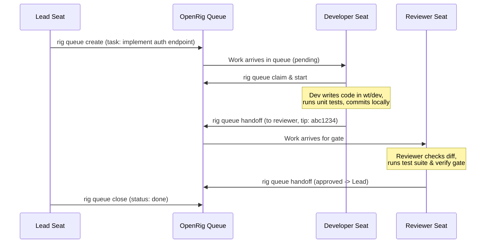

# 03. The Durable Work Queue

In human development teams, work is tracked on an issue tracker (Jira, Linear, GitHub Issues) rather than disappearing in Slack conversations. 

The OpenRig queue provides this exact durable foundation for AI agents.

---

## What is a Queue Item (`qitem`)?

A `qitem` is a persistent JSON record stored in the local SQLite database managed by the OpenRig daemon (`~/.openrig/daemon.db`).

Every queue item tracks:
- **`qitemId`**: Unique identifier (e.g. `qitem-20261011092845-78dc8c58c043cd2e`)
- **`sourceSession`**: Who issued or created the work item (e.g. `lead@my-team` or `human@my-team`)
- **`destinationSession`**: The seat responsible for delivering it (e.g. `go-dev@my-team`)
- **`state`**: Lifecycle state (`pending`, `claimed`, `in-progress`, `blocked`, `done`, `parked`)
- **`priority`**: Scheduling priority (`urgent`, `routine`, `low`)
- **`body`**: Task specification, acceptance criteria, and relevant file pointers
- **`chainOfRecord`**: History of handoffs between agents

---

## Typical Lifecycle of a Task



---

## Essential Queue Commands

### 1. Listing Items
```bash
rig queue list
```
Filter for unfinished or blocked work:
```bash
rig queue list --filter state=pending
rig queue list --filter state=blocked
```

### 2. Inspecting an Item
```bash
rig queue show <qitem-id>
```

### 3. Claiming & Handoff
```bash
# Claim work:
rig queue claim <qitem-id>

# Hand off to another seat with evidence:
rig queue handoff <qitem-id> --to dev-team-reviewer@dev-team --evidence "Tip 96a09a1 in worktree"
```

---

Next: [04 — Safety, Guardrails & Git Guards](04-safety-and-guardrails.md)
