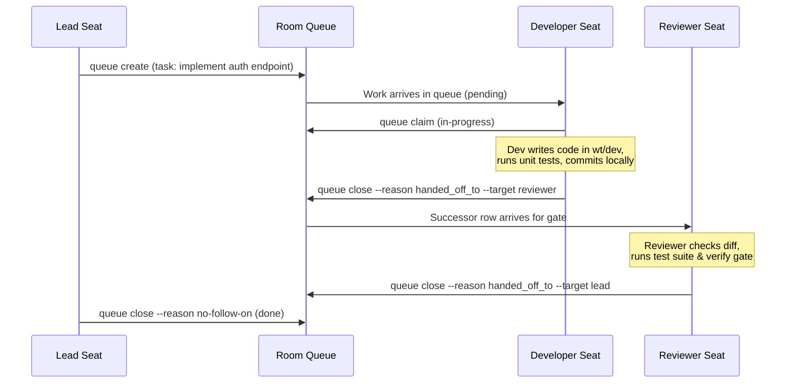

# 03. The Durable Work Queue

In human development teams, work is tracked on an issue tracker (Jira, Linear, GitHub Issues) rather than disappearing in Slack conversations. 

Each room has its own durable queue, owned by the local runtime (`agenthub-runtime`).

---

## What is a Queue Item (`qitem`)?

A `qitem` is a persistent row in the room's SQLite store (`~/.config/4genthub/rooms/<room>/queue.sqlite`). The daemon is its only writer, and every change appends a line to an audit trail of transitions (who, when, from-state, to-state, note).

Every queue item tracks:
- **`qitem_id`**: Unique identifier (e.g. `qitem-20261011092845-78dc8c58c043cd2e`)
- **source / destination session**: who created the item and the seat responsible for it
- **`state`**: one of `pending`, `in-progress`, `blocked`, `handed-off`, `done`
- **`priority`**, **`summary`**, **`body`**: the task specification
- **chain of record**: the history of handoffs between seats

`done` and `handed-off` are terminal: a handed-off row is never reopened, and the work continues in the successor row it creates.

---

## Typical Lifecycle of a Task



---

## Essential Queue Commands

All verbs are `4genteam room queue <verb> <room> ...`. `create`, `update`, `claim` and `close` act as the calling seat's own session (read from `$AGENTHUB_SESSION_NAME`) and refuse when it is unset.

```bash
# Listing (active work only, or one state)
4genteam room queue list dev-team --active-only
4genteam room queue list dev-team --state blocked

# Inspect a row and its transitions
4genteam room queue show dev-team <qitem-id>

# Create, claim, note
4genteam room queue create dev-team --to agenthub--dev-team--dev --summary 'implement auth endpoint'
4genteam room queue claim dev-team <qitem-id>
4genteam room queue update dev-team <qitem-id> --note 'tests green at 96a09a1'

# Close; a handoff names the session that receives the work
4genteam room queue close dev-team <qitem-id> --reason handed_off_to --target agenthub--dev-team--reviewer
```

Closure reasons: `handed_off_to`, `blocked_on`, `denied`, `canceled`, `no-follow-on`, `escalation`, `superseded`.

---

Next: [04 — Safety, Guardrails & Git Guards](04-safety-and-guardrails.md)
